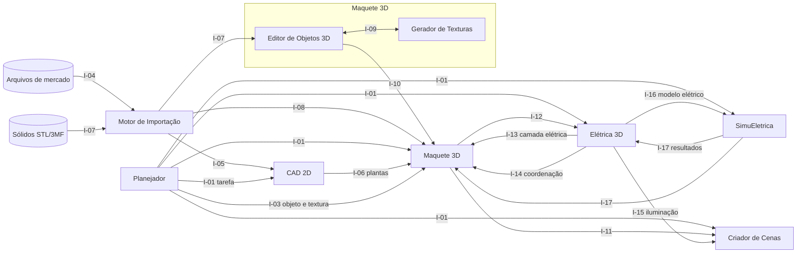

# Integrações entre os componentes

| Campo | Valor |
|---|---|
| Versão do documento | 1.0 — 29/10/2026 (derivado da especificação da plataforma 1.8) |
| Estado | Proposta de contrato (ainda não implementada) |
| Abrangência | Todas as trocas de dados entre os seis aplicativos, os módulos internos e o Motor de Importação |

Os aplicativos da plataforma são independentes: cada um tem instalação, executável e arquivos próprios. **A única forma de integração é por arquivos e pacotes versionados.** Nenhum aplicativo lê o banco interno de outro, e nenhum aplicativo altera o arquivo de outro.

## 1. Mapa das integrações



O retorno de tarefa (I-02) vai de cada aplicativo para o Planejador e não aparece no diagrama para não poluí-lo.

## 2. Princípios

1. Compartilhar arquivos/pacotes versionados, não bancos internos de outros aplicativos.
2. Utilizar **IDs estáveis**, unidades explícitas, eixos e matrizes de transformação em cada camada.
3. **Não sobrescrever o arquivo do outro software**: cada aplicativo produz seu projeto e arquivos derivados próprios.
4. Permitir revisão offline por arquivo, com sincronização opcional futura.
5. Identificar **versão da origem**, hash e adaptador de conversão.
6. Distinguir geometria de visualização (GLB/STL/OBJ) de propriedades semânticas (paredes, tomadas, circuitos, ancoragem): glTF/GLB sozinho não garante informações MEP completas.
7. **Somente leitura na origem:** quem recebe um pacote trabalha sobre uma cópia ou referência; mudanças voltam como pacote novo ou como solicitação, nunca como escrita no arquivo do outro aplicativo.
8. **Revisão explícita:** toda atualização vinda de outro aplicativo é comparada com a versão anterior e só é aplicada após confirmação do usuário.

## 3. Catálogo das integrações

| ID | Origem | Destino | Conteúdo | Gatilho | Requisitos |
|---|---|---|---|---|---|
| I-01 | Planejador | Qualquer aplicativo | Tarefa: aplicativo responsável, entradas, parâmetros, prazo e dependências | Tarefa liberada e aberta pelo usuário | RFP-004, RFP-005 |
| I-02 | Qualquer aplicativo | Planejador | Retorno: arquivos produzidos, situação, pendências e alertas | Usuário conclui ou atualiza a tarefa | RFP-006, RFP-007 |
| I-03 | Planejador | Maquete 3D | Vínculo objeto–textura, com destino no objeto inteiro ou numa face | Tarefa de objeto com texturas | RFP-008, RFP-009 |
| I-04 | Arquivos de mercado | Motor de Importação | DWG, DXF, IFC, PDF, SVG, imagens, malhas | Comando Importar | RFI-001 a RFI-018 |
| I-05 | Motor de Importação | CAD 2D | Entidades 2D, camadas, blocos, cotas e escala | Confirmação da importação | RF2D-011 a RF2D-013 |
| I-06 | CAD 2D | Maquete 3D | Pacote de arquitetura 2D: pavimentos, paredes, portas, janelas, ambientes, cotas e relações | Publicação de revisão da planta | RF3D-001 a RF3D-003, RF3D-017 |
| I-07 | Sólidos STL/3MF | Editor de Objetos 3D | Malha, unidade e, no 3MF, cores e materiais | Comando Importar objeto 3D | RF3D-045 a RF3D-048, RFI-019, RFI-021 |
| I-08 | Motor de Importação | Maquete 3D | DWG, DXF e IFC direto para a maquete | Comando Importar | RF3D-002, RF3D-014 |
| I-09 | Gerador de Texturas | Editor de Objetos 3D (e Maquete) | Textura: mapas, parâmetros, escala física e versão | Aplicação de textura | RFTX-013 a RFTX-015, RF3D-053 |
| I-10 | Editor de Objetos 3D | Maquete 3D | Objeto da biblioteca e suas instâncias ancoradas | Inserir na maquete | RF3D-029 a RF3D-035 |
| I-11 | Maquete 3D | Criador de Cenas | Pacote de cena visual: geometria, materiais, texturas, objetos e pivôs | Publicação da maquete | RFC-001, RFC-002, RFC-017 |
| I-12 | Maquete 3D | Elétrica 3D | Pacote de maquete arquitetônica: superfícies, volumes, níveis, IDs e transformações | Publicação da maquete | RFE-002, RFE-003, RFE-017 |
| I-13 | Elétrica 3D | Maquete 3D | Camada elétrica: condutos, cabos, caixas, pontos, circuitos e âncoras | Publicação do projeto elétrico | RFE-016 |
| I-14 | Elétrica 3D | Maquete 3D | Solicitação de coordenação: rasgos, furos, prumadas e aberturas propostos | Interferência ou necessidade de abertura | Seção 4 do [Elétrica 3D](Eletrica_3D.md) |
| I-15 | Elétrica 3D | Criador de Cenas | Pontos de luz, interruptores, comandos e, se houver, arquivo fotométrico | Publicação do projeto elétrico | RFE-030, RFC-016 |
| I-16 | Elétrica 3D | SimuEletrica | Modelo elétrico: topologia, circuitos, fases, condutores, fontes, proteções e vínculo com a malha 3D | Exportação para simulação | SIM-001 a SIM-003 |
| I-17 | SimuEletrica | Elétrica 3D e Maquete 3D | Resultados: correntes, tensões, temperaturas, disparos e alertas por segmento e instante | Exportação de resultados | SIM-046, RNF-SIM-07 |

## 4. Pacotes de intercâmbio

| Pacote lógico | Origem | Destino | Conteúdo |
|---|---|---|---|
| Tarefa | Planejador | Qualquer aplicativo | Tarefa, aplicativo responsável, entradas, parâmetros, prazo e dependências |
| Retorno de tarefa | Qualquer aplicativo | Planejador | Arquivo produzido, situação, pendências e alertas |
| Vínculo objeto–textura | Planejador | Maquete 3D | Tarefa, objeto, textura e destino (objeto inteiro ou face) |
| Arquitetura 2D | CAD 2D | Maquete 3D | Pavimentos, paredes, portas, janelas, cotas e relações |
| Maquete arquitetônica | Maquete 3D | Elétrica 3D | Superfícies, volumes, níveis, IDs de objeto, transformações |
| Disciplina elétrica | Elétrica 3D | Maquete 3D | Condutos, cabos, caixas, tomadas, luminárias, circuitos e âncoras |
| Cena visual | Maquete 3D | Criador de Cenas | Geometria, materiais, skins, objetos e seus pivôs |
| Estado de iluminação | Elétrica 3D (opcional) | Criador de Cenas | IDs de pontos de luz, interruptores e comandos; sem pretensão de validar elétrica |
| Modelo elétrico para simulação | Elétrica 3D | SimuEletrica | Topologia (nós/arestas), circuitos, fases, condutores, fontes, equipamentos, proteções, modelos e links com malha 3D |
| Cenário de simulação | SimuEletrica | SimuEletrica | Perfil de carga, condições iniciais, falhas injetadas, tempo, versão do solver e hipóteses |
| Resultados simulados | SimuEletrica | Elétrica 3D / Maquete 3D (visualização opcional) | Correntes, tensões, temperaturas estimadas, disparos, alertas, segmentos e instantes, sem modificar projeto-fonte |
| Objeto 3D | Editor de Objetos 3D | Maquete 3D e outras maquetes | Geometria GLB, pivô, dimensões, texturas vinculadas, miniatura, origem e licença |
| Textura | Gerador de Texturas | Editor de Objetos 3D e Maquete 3D | Mapas, parâmetros procedurais, escala física, miniatura, autoria e versão |
| Solicitação de coordenação | Elétrica 3D | Maquete 3D | Rasgos, furos, prumadas e aberturas propostos, com localização e justificativa |

**Formato recomendado:** pacote nativo de intercâmbio com manifest JSON versionado + malhas GLB + texturas + propriedades/IDs. **IFC** pode ser oferecido em paralelo para BIM conforme homologação. A nomenclatura final das extensões nativas deve ser definida na implementação, evitando conflito com `.msuite` do MultiSuite.

### 4.1. Manifesto comum (*proposta*)

Todo pacote traz um manifesto com a mesma estrutura:

```json
{
  "schema_version": "1.0",
  "package_type": "arquitetura_2d",
  "package_id": "pkg-0001",
  "revision": "rev-003",
  "created_by": {"application": "CAD2D", "version": "0.1.0"},
  "created_at": "2026-10-29T16:50:00-03:00",
  "units": "mm",
  "axes": {"up": "Z", "handedness": "right"},
  "source_refs": [
    {"package_id": "pkg-0000", "revision": "rev-002", "hash": "sha256-..."}
  ],
  "files": [
    {"path": "modelo.json", "hash": "sha256-..."},
    {"path": "geometria/terreo.glb", "hash": "sha256-..."}
  ]
}
```

Tipos de pacote previstos: `tarefa`, `retorno_tarefa`, `arquitetura_2d`, `maquete`, `cena_visual`, `objeto_3d`, `textura`, `camada_eletrica`, `solicitacao_coordenacao`, `estado_iluminacao`, `modelo_eletrico`, `cenario_simulacao` e `resultado_simulacao`. A extensão dos arquivos será definida na implementação, sem conflito com `.msuite`.

## 5. Detalhamento por integração

### I-01 e I-02 — Planejador e aplicativos
- O Planejador entrega um pacote `tarefa` e abre o aplicativo responsável com ele.
- O aplicativo devolve um `retorno_tarefa` com os arquivos produzidos e seus hashes.
- O Planejador libera as tarefas dependentes somente quando todas as anteriores estão concluídas.
- O Planejador nunca abre ou altera o conteúdo dos arquivos produzidos.

### I-03 — Vínculo objeto–textura
- A textura é referência à entidade da biblioteca, com `textura_id` e versão; não é copiada para dentro do objeto.
- Destino: `objeto` (objeto inteiro) ou `face`, com identificador estável da face ou grupo de faces.
- **Em aberto:** se o objeto acompanha automaticamente uma nova versão da textura ou mantém a vinculada até atualização explícita.

### I-06 — CAD 2D para Maquete 3D
- Conteúdo semântico (paredes com espessura, altura, material; aberturas com peitoril e altura; ambientes; pavimentos com cota base e pé-direito), e não apenas linhas.
- Cada objeto mantém identificador persistente; a Maquete usa esses identificadores para atualizar só o que mudou (RF3D-017) e para ancorar objetos e pontos elétricos.
- A Maquete nunca escreve na planta: mudanças necessárias voltam ao CAD 2D como revisão feita pelo usuário.

### I-07 — Sólidos do MultiCAD e outros
- Aceitos: STL (texto e binário) e 3MF. Recusados com orientação: `.mcad`, `.msuite` e G-code.
- Unidade padrão para origem MultiCAD: milímetro. Eixos: convenção a confirmar no exportador do MultiCAD antes de definir a conversão padrão.
- A origem (arquivo, hash, data) é registrada para permitir a atualização da geometria preservando texturas (RF3D-056).

### I-09 e I-10 — Módulos internos da Maquete
- São interfaces internas do mesmo aplicativo, mas seguem os mesmos pacotes (`textura`, `objeto_3d`) para permitir exportar e importar texturas e objetos entre maquetes.
- Instância na maquete: `instance_id`, `asset_id`, versão do objeto, pavimento, transformação, âncora e substituições de material.

### I-11 — Maquete 3D para Criador de Cenas
- Geometria em GLB com materiais metal/rugosidade, mais metadados: identificadores, pivôs e eixos de portas e janelas (para animação), áreas de água e vegetação marcadas.
- A cena guarda referência à revisão da maquete; câmeras, animações e efeitos ficam no projeto de cena e são preservados quando a maquete muda.

### I-12 a I-14 — Maquete 3D e Elétrica 3D
- O Elétrica 3D recebe a maquete em somente leitura e ancora cada elemento a uma superfície pelo identificador do hospedeiro, com deslocamento e altura.
- Ao receber nova revisão da maquete, compara, sinaliza os itens afetados e pede confirmação antes de reposicionar ou desconectar.
- A camada elétrica volta para a Maquete apenas para exibição e coordenação.
- Rasgos, furos e aberturas nunca são aplicados automaticamente: viram `solicitacao_coordenacao`, aprovada ou recusada na Maquete.

Exemplo de vínculo elétrico:

```json
{
  "schema_version": "1.0",
  "discipline": "electrical",
  "project_id": "eletrica-001",
  "architecture_ref": {
    "project_id": "maquete-001",
    "revision": "rev-008",
    "hash": "sha256-da-versao-validada"
  },
  "units": "mm",
  "objects": [
    {
      "id": "tomada-101",
      "type": "socket",
      "floor_id": "terreo",
      "anchor": {"host_id": "parede-12", "offset_mm": [1200, 0, 300]},
      "circuit_id": "circuito-01"
    }
  ]
}
```

### I-15 — Elétrica 3D para Criador de Cenas
- Somente o necessário para a simulação visual: posição e identificador das luminárias, relação interruptor–luminária, potência luminosa e arquivo fotométrico quando houver.
- O Criador de Cenas não valida nem calcula nada da instalação elétrica.

### I-16 e I-17 — Elétrica 3D e SimuEletrica
- O SimuEletrica abre o pacote elétrico sem precisar do Elétrica 3D instalado (SIM-001) e valida versão, unidades e identificadores (SIM-002).
- Os resultados referenciam a revisão e o hash do pacote elétrico de origem; se o projeto elétrico mudar, o SimuEletrica detecta a divergência e não mistura resultados de revisões diferentes.
- Os resultados voltam como camada opcional de visualização e nunca alteram bitolas, rotas, circuitos ou proteções.

## 6. Contrato de tarefa

Definido no documento do [Planejador](Planejador.md#contrato-de-tarefa-proposta).

## 7. Atualização e conflitos

| Situação | Comportamento |
|---|---|
| Nova revisão de um pacote de origem | Comparar por identificador e geometria, mostrar inclusões, alterações e exclusões, aplicar após confirmação |
| Elemento dependente perdeu o hospedeiro (parede removida) | Marcar como pendente de revisão, sem apagar |
| Versão de esquema desconhecida | Recusar com mensagem; nunca abrir parcialmente sem aviso |
| Hash diferente do registrado | Avisar que a origem mudou e oferecer reimportação |
| Arquivo referenciado ausente | Sinalizar e pedir a localização (RFI-016) |

## 8. Etapas de implementação das integrações

| Etapa | Integrações | Depende de |
|---|---|---|
| G1 — Manifesto e pacote comum | Estrutura da seção 4.1 em `ea_pacote` | Núcleo Comum N2 |
| G2 — Planta para maquete | I-06 | CAD 2D A2, Maquete 3D M1 |
| G3 — Tarefas | I-01, I-02 | Planejador P2 |
| G4 — Objetos e texturas | I-03, I-07, I-09, I-10 | Editor O2–O4, Texturas T1–T4, Planejador P4 |
| G5 — Cena visual | I-11 | Maquete 3D M3, Criador de Cenas C1 |
| G6 — Disciplina elétrica | I-12, I-13, I-14 | Elétrica 3D E1–E4 |
| G7 — Iluminação | I-15 | Elétrica 3D E6, Criador de Cenas C5 |
| G8 — Simulação | I-16, I-17 | SimuEletrica S1 |
