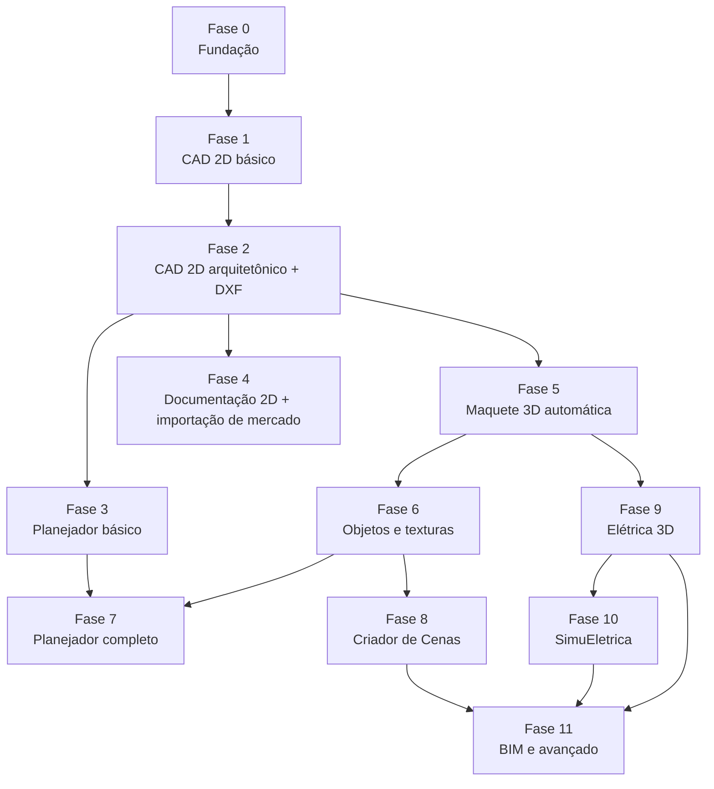

# Plano de desenvolvimento

| Campo | Valor |
|---|---|
| Versão do documento | 1.0 — 29/10/2026 |
| Estado | Planejamento (nenhuma fase iniciada) |
| Base | Etapas definidas em cada documento de componente |

O plano organiza as etapas de todos os componentes em **fases** sequenciais. Cada fase só começa quando a anterior atende seus critérios de saída e quando as decisões indicadas estiverem tomadas. A ordem segue a prioridade definida na especificação: **CAD 2D primeiro**, depois a maquete, e só então as disciplinas que dependem dela. O Planejador, embora seja a primeira etapa da linha de produção, entra depois do CAD 2D básico, porque suas tarefas precisam de um aplicativo que as execute.

## 1. Visão das fases



## 2. Fases

| Fase | Objetivo | Etapas incluídas | Decisões necessárias antes | Critério de saída |
|---|---|---|---|---|
| **0 — Fundação** | Base técnica e estrutura do repositório | Núcleo N1, N2, N3; Integrações G1 | Reaproveitamento da suíte CHATGPT; nomes dos pacotes | Testes da geometria 2D passando; projeto com paredes gravado e relido sem diferença; aplicativo vazio no padrão visual |
| **1 — CAD 2D básico** | Editor de desenho preciso | CAD 2D A1 | — | Retângulo de 4.000 × 3.000 mm desenhado por coordenadas, salvo e reaberto |
| **2 — CAD 2D arquitetônico** | Planta com objetos inteligentes e DXF | CAD 2D A2; Importação I1, I2 | — | Critérios 1 a 5 da primeira versão do CAD 2D; DXF importado com camadas e blocos |
| **3 — Planejador básico** | Tarefas em grafo ligadas ao CAD 2D | Planejador P1, P2; Integrações G3 | — | Tarefa "Planta do térreo" aberta no CAD 2D e devolvida concluída |
| **4 — Documentação 2D e mercado** | Pranchas e importação ampla | CAD 2D A3, A4; Importação I3, I6 | Biblioteca de DWG | DXF editável e PDF em escala; DWG real importado com relatório |
| **5 — Maquete 3D automática** | Edificação 3D a partir das plantas | Núcleo N4, N5; Importação I5; Maquete M1, M2, M4; Integrações G2 | — | Dois DXF montados em maquete com níveis; revisão da planta aplicada sem perder ajustes |
| **6 — Objetos e texturas** | Editor de Objetos e Gerador de Texturas | Núcleo N6; Importação I4; Editor O1–O5; Texturas T1–T4; Maquete M3 | Eixos do MultiCAD; versionamento das texturas vinculadas | STL do MultiCAD com duas texturas, exportado em GLB e inserido na maquete |
| **7 — Planejador completo** | Acompanhamento de obra e objetos | Planejador P3, P4; Integrações G4 | Texturas em superfícies pelo Planejador | Curva S de um cronograma; bancada com texturas vinculadas por tarefa |
| **8 — Criador de Cenas** | Imagens, vídeos e passeios | Criador C1–C5; Integrações G5, G7 | Motor de renderização | Cena diurna e noturna, vídeo de passeio, porta abrindo e vegetação ao vento |
| **9 — Elétrica 3D** | Instalações sobre a maquete | Elétrica E1–E5; Integrações G6 | — | Critérios 1 a 9 do Elétrica 3D |
| **10 — SimuEletrica** | Simulação e mapa térmico | SimuEletrica S1–S4; Integrações G8 | Forma de integração do OpenDSS e do ngspice | Testes de aceitação 1 a 12 do SimuEletrica |
| **11 — BIM e avançado** | Interoperabilidade e recursos avançados | Importação I7, I8; CAD 2D A5; Maquete M5, M6; Editor O6; Texturas T5; Elétrica E6; Criador C6; SimuEletrica S5 | Estratégia de IFC | Definido ao iniciar a fase |

Itens futuros (Editor O7, Texturas T6 e requisitos marcados como "Futuro") ficam fora das fases até serem priorizados.

## 3. Decisões e o momento de cada uma

| Decisão | Necessária até | Opções levantadas |
|---|---|---|
| Reaproveitar componentes da suíte CHATGPT | Fase 0 | Sim, como no MultiCNC; não, núcleo próprio |
| Biblioteca de DWG | Fase 4 | SDK da Open Design Alliance (licenciado), LibreDWG (GPL), conversor externo |
| Convenção de eixos do STL/3MF do MultiCAD | Fase 6 | Confirmar no código do exportador |
| Versionamento das texturas vinculadas | Fase 6 | Acompanhar automaticamente; manter versão até atualização explícita |
| Texturas em superfícies pelo Planejador | Fase 7 | Só objetos; objetos e superfícies |
| Motor de renderização final | Fase 8 | LuxCoreRender; Cycles como processo separado |
| Integração do OpenDSS e do ngspice | Fase 10 | Processo separado; biblioteca; implementação própria |
| Estratégia de IFC | Fase 11 | Leitor próprio do subconjunto; IfcOpenShell isolado |

## 4. Organização do repositório (*proposta*)

```
EngenhariaArquitetura/
├── docs/            especificações, integrações, plano e decisões
├── comum/           Núcleo Comum e Motor de Importação (pacotes Lazarus)
├── planejador/
├── cad2d/
├── maquete3d/       inclui Editor de Objetos 3D e Gerador de Texturas
├── criadorcenas/
├── eletrica3d/
├── simueletrica/
└── testes/          casos de referência e arquivos de homologação
```

## 5. Forma de trabalho

- Desenvolvimento na branch `fila`, com envio frequente ao GitHub durante trabalhos longos.
- Cada etapa termina com seus critérios de saída verificados e registrados.
- Mudanças de requisito atualizam primeiro o documento do componente e o registro de [Decisões](Decisoes.md), depois o código.
- Arquivos de teste reais (DXF, DWG, STL do MultiCAD, IFC) ficam em `testes/` para homologação repetível.
- O próprio plano pode ser o primeiro projeto de teste do Planejador quando ele existir.

## 6. Acompanhamento

| Fase | Situação |
|---|---|
| 0 — Fundação | Não iniciada |
| 1 — CAD 2D básico | Não iniciada |
| 2 — CAD 2D arquitetônico | Não iniciada |
| 3 — Planejador básico | Não iniciada |
| 4 — Documentação 2D e mercado | Não iniciada |
| 5 — Maquete 3D automática | Não iniciada |
| 6 — Objetos e texturas | Não iniciada |
| 7 — Planejador completo | Não iniciada |
| 8 — Criador de Cenas | Não iniciada |
| 9 — Elétrica 3D | Não iniciada |
| 10 — SimuEletrica | Não iniciada |
| 11 — BIM e avançado | Não iniciada |

## Anexo — Entregas da especificação original

As letras abaixo são as entregas da especificação da plataforma 1.8, mantidas para rastreabilidade. Elas foram distribuídas nas etapas dos componentes e nas fases acima.

#### Entrega A — CAD 2D operacional
Viewport, ferramentas de desenho preciso, camadas, paredes, portas, janelas, cotas, salvamento, importação DXF, PDF vetorial/SVG/imagens e exportação de documentação.

#### Entrega B — Importação CAD de mercado
Homologar mecanismo DWG; criar assistente de importação, mapeamento de layers/entidades e relatório de compatibilidade. Acrescentar DGN conforme biblioteca selecionada.

#### Entrega C — Maquete 3D automática
Criar modelo de intercâmbio, associar pavimentos, gerar paredes/vãos/lajes e reconstrução a partir de DXF/DWG e projeto nativo.

#### Entrega D — Editor de Objetos 3D e biblioteca
Criar e modificar objetos por primitivas, importar **STL/3MF de qualquer origem** e GLB/glTF/OBJ, preparar UV, criar/importar skins e materiais PBR/procedurais por **gerador próprio offline**, montar biblioteca de objetos e variantes de skins, instanciar na maquete, posicionar em pavimentos/superfícies e preservar objetos em atualizações da planta.

#### Entrega D2 — Gerador próprio de Skins (obrigatório)
Gerar texturas procedurais offline, importar fotos, torná-las contínuas, gerar/editar mapas PBR, pré-visualizar em superfícies e modelos, salvar skins em biblioteca própria, aplicar a objetos ou superfícies e exportar pacotes/autores. Homologar instalação sem MultiCNC/MultiCAD.

#### Entrega E — BIM e visualização de montagem
Importação IFC, objetos semânticos e hierarquia de pavimentos; materiais, câmera de trabalho e iluminação básica de prévia. Importar malhas 3D de referência. **Renderização ultrarrealista pertence ao Criador de Cenas independente.**

#### Entrega F — Interoperabilidade avançada e modelagem 3D avançada
Adaptadores SKP/RVT, atualização incremental, geração assistida de skins por IA, interpretações assistidas de plantas digitalizadas, exportação BIM, edição avançada de malhas, objetos paramétricos de biblioteca e validações avançadas.

**Observação:** suporte a DWG é requisito essencial do produto, embora sua homologação possa ocorrer após o motor DXF; a disponibilidade não será anunciada antes de funcionar em arquivos de teste reais.

| Entrega | Aplicativo | Pré-requisito de integração | Resultado |
|---|---|---|---|
| Q — Planejador | Planejador | Contrato de tarefa ([Planejador](Planejador.md)) | Tarefas em grafo, Gantt, vínculos com aplicativos e objetos |
| G — Cenas iniciais | Criador de Cenas | Maquete exportável | Câmeras, iluminação e render estático |
| H — Cenas dinâmicas | Criador de Cenas | G + objetos com pivô | Pessoas, vento, água, portas e vídeo |
| I — Elétrica básica | Elétrica 3D | Contrato de maquete e importador | Pontos, quadros, eletrodutos e cabos |
| J — Circuitos e relatórios | Elétrica 3D | I | Circuitos, quantitativos, diagramas e conflitos |
| K — Coordenação 3D | Maquete 3D + Elétrica 3D | J + IDs estáveis | Sobreposição, revisões e solicitações de alteração |
| L — Interop iluminação | Elétrica 3D + Criador de Cenas | H + J | Estados de luminárias para simulações visuais |
| M — SimuEletrica inicial | SimuEletrica | J + contrato da disciplina elétrica | Grafo elétrico, cargas, perfis, fluxo de potência e queda de tensão |
| N — Proteção e falhas | SimuEletrica | M + modelos e parâmetros de dispositivos | Curtos, sobrecargas, disparos e cenários comparáveis |
| O — Térmica e visualização 3D | SimuEletrica | N + rotas 3D, cabos e dados térmicos | Temperaturas estimadas, evolução temporal e mapa de calor por segmento |
| P — RLC, qualidade e transitórios | SimuEletrica | O + motor especializado | Efeitos capacitivos/indutivos, harmônicos, chaveamento e estudo de interferência conduzida |

**Normas e responsabilidade técnica:** consultar e aplicar a versão vigente das normas ABNT e dos requisitos legais aplicáveis, em particular às instalações elétricas de baixa tensão e, quando pertinente, a edificações especiais. Verificações automáticas serão assistivas e testadas, **não equivalem a aprovação ou assinatura de projeto elétrico**.

**Estado:** todos os requisitos nesta versão são especificações de produto. A existência de funções nos softwares externos não implica que a integração já esteja implementada.
