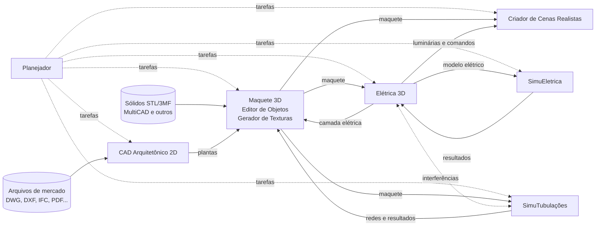

# Documentação — EngenhariaArquitetura

Plataforma de aplicações independentes em Lazarus/Free Pascal para projetos de Engenharia e Arquitetura. Cada aplicativo funciona como uma etapa de uma **linha de produção**: o resultado de uma etapa alimenta a seguinte, por meio de arquivos de intercâmbio versionados.

> **Estado:** fase de especificação e planejamento. Nenhum aplicativo foi implementado ainda.

## Como ler esta documentação

1. Comece pela [Visão geral da plataforma](Visao_Geral_Plataforma.md): aplicativos, objetivos, escopo e requisitos não funcionais comuns.
2. Leia o documento do componente que interessa (tabela abaixo). Cada um traz descrição, requisitos, interface, critérios de aceite e **etapas de desenvolvimento**.
3. Consulte as [Integrações](Integracoes.md) para saber o que cada componente troca com os demais.
4. Veja o [Plano de desenvolvimento](Plano_Desenvolvimento.md) para a ordem das fases e as decisões pendentes.

## Componentes

### Aplicativos

| # | Componente | Documento | Etapas | Resumo |
|---|---|---|---|---|
| 1 | Planejador | [Planejador.md](Planejador.md) | P1–P4 | Tarefas em grafo, cronograma, tarefas executadas nos outros aplicativos e vínculo de texturas aos objetos |
| 2 | CAD Arquitetônico 2D | [CAD_Arquitetonico_2D.md](CAD_Arquitetonico_2D.md) | A1–A5 | Plantas baixas com objetos inteligentes, cotas, camadas, pranchas e normas ABNT |
| 3 | Maquete 3D | [Maquete_3D.md](Maquete_3D.md) | M1–M6 | Reconstrução da edificação por pavimentos a partir das plantas |
| 4 | Criador de Cenas Realistas | [Criador_Cenas.md](Criador_Cenas.md) | C1–C6 | Câmeras, iluminação, animação, natureza, pessoas e renderização final |
| 5 | Elétrica 3D | [Eletrica_3D.md](Eletrica_3D.md) | E1–E6 | Instalações elétricas sobre a maquete, circuitos, quantitativos e coordenação |
| 6 | SimuEletrica | [SimuEletrica.md](SimuEletrica.md) | S1–S5 | Simulação elétrica, falhas, proteções e mapa térmico dos cabos |
| 7 | SimuTubulações | [SimuTubulacoes.md](SimuTubulacoes.md) | TB1–TB6 | Redes prediais de água, gás, ar comprimido, ventilação e esgoto, com simulação de fluidos |

### Módulos internos da Maquete 3D

| Componente | Documento | Etapas | Resumo |
|---|---|---|---|
| Editor de Objetos 3D | [Editor_Objetos_3D.md](Editor_Objetos_3D.md) | O1–O7 | Primitivas, importação de sólidos STL/3MF, biblioteca e instâncias ancoradas |
| Gerador de Texturas | [Gerador_Texturas.md](Gerador_Texturas.md) | T1–T6 | Texturas procedurais e de fotos, materiais metal/rugosidade, aplicação por objeto ou face |

### Componentes comuns

| Componente | Documento | Etapas | Resumo |
|---|---|---|---|
| Núcleo Comum | [Nucleo_Comum.md](Nucleo_Comum.md) | N1–N6 | Geometria, modelo arquitetônico, pacotes, âncoras, visualização 3D e padrão visual |
| Motor de Importação | [Motor_Importacao.md](Motor_Importacao.md) | I1–I8 | Matriz de formatos de mercado, adaptadores e relatório de perdas |

### Documentos transversais

| Documento | Conteúdo |
|---|---|
| [Visão geral da plataforma](Visao_Geral_Plataforma.md) | Aplicativos, objetivos de negócio, escopo, requisitos não funcionais comuns e fontes |
| [Integrações](Integracoes.md) | Catálogo das 23 integrações (I-01 a I-23), pacotes de intercâmbio, manifesto comum, conflitos e etapas G1–G10 |
| [Plano de desenvolvimento](Plano_Desenvolvimento.md) | Fases 0 a 12, decisões necessárias por fase, organização do repositório e acompanhamento |
| [Decisões de projeto](Decisoes.md) | Decisões tomadas, pontos técnicos a confirmar e questões em aberto |

## Linha de produção

## Princípios gerais

- **Aplicativos independentes:** cada um tem instalação, executável e arquivos próprios; nenhum é plugin de outro.
- **Integração só por arquivos:** pacotes versionados com IDs estáveis, unidades explícitas e vínculo com a origem; nenhum aplicativo sobrescreve o arquivo de outro.
- **Tecnologia:** Lazarus/Free Pascal para as interfaces, com motores especializados isolados quando necessário (conversores, renderizadores, simuladores).
- **Unidade interna:** milímetros, em dupla precisão.
- **MultiCNC/MultiCAD:** sistema externo, fora do projeto; serve de referência de organização e padrão visual, e dele são aceitos somente os arquivos de sólidos STL e 3MF.

## Identificação dos requisitos

| Prefixo | Componente |
|---|---|
| RFP | Planejador |
| RF2D | CAD Arquitetônico 2D |
| RF3D | Maquete 3D e Editor de Objetos 3D |
| RFTX | Gerador de Texturas |
| RFI | Motor de Importação |
| RFC | Criador de Cenas |
| RFE | Elétrica 3D |
| SIM, RNF-SIM | SimuEletrica |
| ST, ST-NF | SimuTubulações |
| RNF | Requisitos não funcionais comuns |
| I-nn | Integrações |

## Histórico

| Data | Alteração |
|---|---|
| 28/10/2026 | Especificação da plataforma 1.8 e da Planta Baixa 2D 1.0 em documentos únicos |
| 29/10/2026 | Incluído o SimuTubulações (sétimo aplicativo), a partir da especificação recebida em 29/10/2026; integrações I-18 a I-23 e fase 11 do plano. Etapas renomeadas para TB1–TB6 e entrega do Planejador para PL, para não colidir com o Gerador de Texturas e com a entrega Q da especificação |
| 29/10/2026 | Especificação dividida em um documento por componente; criados os documentos de integrações e de plano de desenvolvimento, com etapas por componente. O conteúdo anterior permanece no histórico do git |
