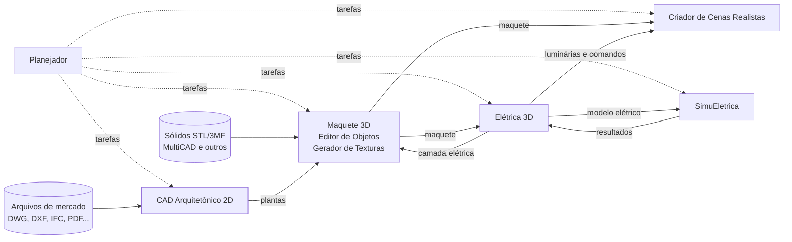

# Documentação — EngenhariaArquitetura

Plataforma de aplicações para projetos de Engenharia e Arquitetura. Cada aplicativo funciona como uma etapa de uma **linha de produção**: o resultado de uma etapa alimenta a seguinte, por meio de arquivos de intercâmbio versionados.

> **Estado:** fase de especificação. Nenhum aplicativo foi implementado ainda.

## Documentos

| Documento | Versão | Conteúdo |
|---|---|---|
| [Especificação da plataforma](Especificacao_Plataforma_Arquitetura.md) | 1.8 | Os seis aplicativos, requisitos funcionais e não funcionais, matriz de formatos, contratos de integração, critérios de aceitação e entregas |
| [Especificação da Planta Baixa 2D](Especificacao_Planta_Baixa_2D.md) | 1.0 | Detalhamento do CAD Arquitetônico 2D: ferramentas, objetos inteligentes, medidas, camadas, normas ABNT e critérios da primeira versão |
| [Decisões de projeto](Decisoes.md) | — | Registro das decisões tomadas durante a concepção e questões em aberto |

### Resumo por aplicativo

[Planejador](../planejador/README.md) · [CAD 2D](../cad2d/README.md) · [Maquete 3D](../maquete3d/README.md) · [Criador de Cenas](../criadorcenas/README.md) · [Elétrica 3D](../eletrica3d/README.md) · [SimuEletrica](../simueletrica/README.md)

## Linha de produção

| # | Aplicativo | Recebe | Produz |
|---|---|---|---|
| P | **Planejador** | — | Tarefas em grafo, cronograma e vínculos com os demais aplicativos |
| A | **CAD Arquitetônico 2D** | Tarefas, arquivos de mercado | Plantas baixas com objetos inteligentes |
| B | **Maquete 3D** | Plantas, sólidos STL/3MF, IFC | Edificação 3D com objetos e texturas |
| C | **Criador de Cenas Realistas** | Maquete, dados de iluminação | Imagens, vídeos e passeios virtuais |
| D | **Elétrica 3D** | Maquete | Projeto elétrico e documentação |
| E | **SimuEletrica** | Modelo elétrico | Simulações, falhas, proteções e mapas térmicos |

## Princípios gerais

- **Aplicativos independentes:** cada um tem instalação, executável e arquivos próprios; nenhum é plugin de outro.
- **Integração só por arquivos:** pacotes versionados com IDs estáveis, unidades explícitas e vínculo com a origem; nenhum aplicativo sobrescreve o arquivo de outro.
- **Tecnologia:** Lazarus/Free Pascal para as interfaces, com motores especializados isolados quando necessário (conversores, renderizadores, simuladores).
- **Unidade interna:** milímetros, em dupla precisão.
- **MultiCNC/MultiCAD:** sistema externo, fora do projeto; serve de referência de organização e padrão visual, e dele são aceitos somente os arquivos de sólidos STL e 3MF.
