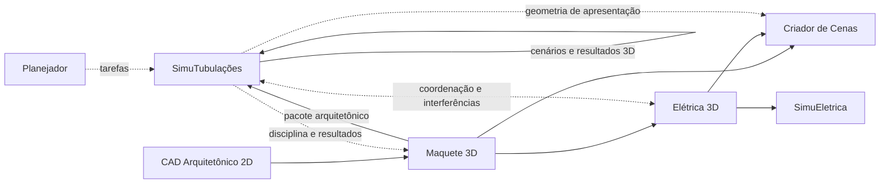

# SimuTubulações 3D

| Campo | Valor |
|---|---|
| Tipo | Aplicativo independente, vinculado à Maquete 3D e coordenado com o Elétrica 3D |
| Versão do documento | 1.0 — 29/10/2026 (derivado da especificação da plataforma 1.8) |
| Estado | Proposta de requisitos (ainda não implementada) |
| Papel na linha de produção | Projeta e simula as redes prediais de fluidos sobre a maquete: água fria e quente, gás, ar comprimido, ventilação e esgoto |
| Recebe | Pacote arquitetônico da Maquete 3D; disciplina elétrica como referência geométrica; tarefas do Planejador |
| Produz | Disciplina de tubulações, cenários, resultados (pressão, vazão, temperatura, caimentos), mapas 3D, quantitativos e relatórios |

> Integrações com os demais componentes: [Integrações](Integracoes.md). Ordem de desenvolvimento: [Plano de desenvolvimento](Plano_Desenvolvimento.md).

## Visão resumida

Software para projetar, representar e simular **redes prediais de água fria/quente, gás combustível (GN e GLP), ar comprimido e ventilação/ar em dutos, e esgoto sanitário**, usando a geometria 3D da edificação como referência. Contém **editor próprio de redes de tubos/dutos e componentes** e **motores de cálculo adequados a cada tipo de fluido e regime de escoamento**. Analisa pressão, vazão, perdas, desníveis, capacidades, eventos, falhas e, quando o modelo permitir, temperatura e mapas espaciais de resultados. Atua como **executável autônomo**, não é plugin do Maquete 3D ou do Elétrica 3D. Os resultados são estudos condicionados por hipóteses e não substituem projeto, certificação nem comissionamento por profissional habilitado.

> As etapas deste componente usam o prefixo **TB** para não se confundir com as etapas T do [Gerador de Texturas](Gerador_Texturas.md).

## Definição e objetivo

**Nome de trabalho:** SimuTubulações — Editor 3D e Simulador de Redes de Fluidos e Esgoto.  
**Tipo:** aplicativo independente (o sétimo da plataforma, contando o Planejador), com instalação, executável, configurações e formato de projeto próprios.  
**Entrada primária:** pacote versionado da Maquete 3D ou importação arquitetônica interoperável.  
**Saídas:** disciplina tridimensional de tubulações, cenários, resultados de engenharia, alertas e relatórios.  
**Escopo:** redes internas e prediais, com possibilidade de expansão posterior para redes externas/industriais.  
**Condição:** requisitos propostos, não funcionalidades implementadas.

A edição de redes e os cálculos pertencem ao mesmo aplicativo **SimuTubulações** nesta fase. Não é necessário criar outro executável nem instalar o MultiCNC. É possível futuramente separar um projetista de tubulações de um solver externo, mediante contrato de intercâmbio, sem que essa divisão seja exigência desta versão.

**Arquitetura lógica:**



**Princípios de independência:**
1. SimuTubulações pode abrir um pacote de maquete previamente exportado, mesmo que Maquete 3D e Elétrica 3D não estejam instalados ou em execução.
2. SimuTubulações não edita diretamente o arquivo da Maquete 3D ou do Elétrica 3D; produz sua própria disciplina e solicita alterações arquitetônicas quando necessário.
3. Cada aplicativo conserva revisão, autoria, unidades e identificadores próprios.
4. Redes de gás, ar comprimido, ar de ventilação, água e esgoto **não compartilham grafo de fluido**, mesmo quando cruzam no espaço.
5. Os resultados numéricos devem registrar método, condições de contorno, propriedades dos fluidos, versão do solver e advertências de validade.

## Redes e comportamentos físicos previstos

| Rede | Objetos típicos | Parâmetros principais | Fenômenos mínimos previstos |
|---|---|---|---|
| Água fria pressurizada | Alimentação, tubos, registro, caixa d'água, bomba, torneira | Vazão, pressão, DN/diâmetro interno, cota, material | Perda de carga, pressão residual, consumo, velocidades, bombeamento |
| Água quente | Aquecedor, misturador, válvula, ramal, recirculação | Temperatura, isolamento, vazão, pressão, perdas térmicas | Distribuição, tempo de renovação e queda térmica estimada conforme modelo |
| Gás natural/GLP | Entrada, regulador, válvula, medidor, aparelho, tubulação | Composição/propriedades, pressão, consumo, cota, rugosidade | Queda de pressão em fluido compressível, consumo e cenário hipotético de vazamento |
| Ar comprimido | Compressor, reservatório, filtro, regulador, secador, ponto de uso | Pressão, temperatura, vazão normalizada, regime, perdas | Queda de pressão, consumo intermitente, expansão, vazamentos estimados |
| Ar de ventilação e climatização | Duto, curva, grelha, difusor, registro, ventilador | Área do duto, vazão volumétrica, velocidade, perda localizada | Equilíbrio de rede de dutos, queda de pressão, distribuição de ar |
| Esgoto sanitário | Ramal, tubo de queda, ventilação, sifão, caixa de inspeção | Declividade, diâmetro, cota de fundo, demanda, conexões | Escoamento por gravidade, capacidade, refluxo, contrapendência, pontos de acúmulo |

**Distinções mandatórias:**
- Para água pressurizada, o modelo deve tratar rede hidráulica e demanda; **água quente** exige parâmetros térmicos adicionais.
- Para gás e ar comprimido, utilizar propriedades e equações de gases nos domínios de pressão/temperatura aplicáveis; não reutilizar sem justificativa um solver incompressível.
- Para dutos de ar, aplicar características geométricas, perdas distribuídas e localizadas e equipamentos próprios; não confundir com tubulação de ar comprimido.
- Para esgoto, trabalhar preferencialmente com **condutos com superfície livre, declividade e ventilação**, não presumir que todo o circuito opere cheio ou pressurizado. Trechos de recalque são um caso separado.
- **Gases medicinais e vácuo clínico** não são automaticamente cobertos pelo modelo genérico de ar/gás: são disciplina especializada que exige requisitos técnicos adicionais (por exemplo ABNT NBR 12188), a ser aprovada separadamente.

## Requisitos funcionais — importação e modelagem 3D

| ID | Prioridade | Requisito funcional / descrição |
|---|---|---|
| ST-001 | Obrigatório | Importar referência arquitetônica com um ou vários pavimentos e suas cotas/níveis, preservando escala e IDs. |
| ST-002 | Obrigatório | Permitir trabalhar sem aplicativo Maquete 3D instalado, desde que exista pacote arquitetônico válido. |
| ST-003 | Obrigatório | Criar redes independentes de água fria, água quente, gás, ar comprimido, ar de ventilação e esgoto. |
| ST-004 | Obrigatório | Desenhar segmentos de tubulações e dutos em 3D com trajetos retos, curvas e desvios. |
| ST-005 | Obrigatório | Inserir tês, curvas, luvas, reduções, conexões, uniões e juntas com conectores identificados. |
| ST-006 | Obrigatório | Inserir válvulas, registros, retenções, reguladores, filtros e equipamentos por categoria de rede. |
| ST-007 | Obrigatório | Configurar diâmetro nominal e interno, seção (circular/retangular para dutos), espessura e especificação do material. |
| ST-008 | Obrigatório | Registrar comprimento real, cota, declividade, rugosidade e classificação da instalação de cada segmento. |
| ST-009 | Obrigatório | Definir fontes, reservatórios, entrada de rede, bombas, compressores, ventiladores, saídas, consumidores e descargas. |
| ST-010 | Obrigatório | Editar parâmetros de cada componente e exibir propriedades por objeto e por circuito. |
| ST-011 | Obrigatório | Manter grafo de conexões coerente e destacar pontas abertas e conexões incompatíveis. |
| ST-012 | Obrigatório | Snap em superfícies, eixos, centros e conectores; suportar alinhamento a níveis e shafts. |
| ST-013 | Obrigatório | Editar posição, rotação, elevação e diâmetro sem perder vínculos válidos, oferecendo correção quando necessário. |
| ST-014 | Obrigatório | Oferecer cores, visibilidade e filtros de disciplina, pavimento, sistema e estado de simulação. |
| ST-015 | Obrigatório | Medir trechos, comprimentos totais, elevações, cotas de entrada/saída e quantitativos. |
| ST-016 | Obrigatório | Fazer verificação geométrica de colisões com arquitetura, elétrica e outras redes de tubulação carregadas. |
| ST-017 | Importante | Gerar propostas de rota ou de desvio com restrições de acesso, manutenção e altura; exigir confirmação. |
| ST-018 | Importante | Importar/exportar IFC MEP quando houver suporte semântico homologado; GLB é apenas visualização. |
| ST-019 | Importante | Importar dados complementares de DXF, DWG, CSV e tabelas de componentes por adaptadores validados. |
| ST-020 | Obrigatório | Detectar alterações da revisão arquitetônica e preservar histórico de alinhamento e conflitos. |

## Requisitos funcionais — cálculo de água fria e quente

| ID | Prioridade | Requisito funcional / descrição |
|---|---|---|
| ST-021 | Obrigatório | Atribuir demandas simultâneas ou por perfis horários nos pontos de consumo de água. |
| ST-022 | Obrigatório | Calcular vazão nos segmentos, pressão nodal e perdas distribuídas/localizadas com método registrado. |
| ST-023 | Obrigatório | Considerar cotas geométricas, reservatórios, pressão de alimentação e desempenho de bombas. |
| ST-024 | Importante | Simular abertura/fechamento de registros, indisponibilidade de bombas e interrupção da alimentação. |
| ST-025 | Importante | Avaliar água quente com temperaturas de entrada, isolamento, trocas térmicas e recirculação, se habilitado. |
| ST-026 | Importante | Estudar variações temporais de consumo, níveis de reservatório e pressão, quando o solver suportar. |
| ST-027 | Avançado | Simular golpes de aríete/transitórios com solver especializado, dados de inércia, elasticidade e condições de contorno. |

## Requisitos funcionais — gás, ar comprimido e dutos

| ID | Prioridade | Requisito funcional / descrição |
|---|---|---|
| ST-028 | Obrigatório | Cadastrar gás natural e GLP como redes distintas com propriedades de fluido configuráveis e fontes documentadas. |
| ST-029 | Obrigatório | Calcular vazões, pressões e perdas em rede de gás dentro do domínio de validade do modelo adotado. |
| ST-030 | Obrigatório | Representar válvulas, reguladores e pontos consumidores com parâmetros declarados. |
| ST-031 | Importante | Simular vazamento hipotético e perda de alimentação da rede, identificando nós/trechos afetados. |
| ST-032 | Avançado | Estudar dispersão do gás e concentração em ambientes somente com modelo tridimensional especializado, ventilação e hipóteses explícitas; não classificar ambiente como seguro por padrão. |
| ST-033 | Obrigatório | Calcular consumo e queda de pressão em redes de ar comprimido, considerando compressores e reservatórios. |
| ST-034 | Importante | Simular horários de consumo, estado do compressor, reguladores, perdas e vazamentos aproximados. |
| ST-035 | Obrigatório | Calcular perdas de carga e distribuição de vazões em rede de dutos de ventilação/ar. |
| ST-036 | Importante | Cadastrar ventiladores, curvas de desempenho, dampers, grelhas e filtros, com seus dados característicos. |
| ST-037 | Avançado | Suportar estudos de conforto, renovação e distribuição espacial do ar apenas mediante módulo apropriado e modelos validados. |

## Requisitos funcionais — esgoto, falhas e análises

| ID | Prioridade | Requisito funcional / descrição |
|---|---|---|
| ST-038 | Obrigatório | Modelar ramais, tubos de queda, coletores, caixas de inspeção, fechos hídricos e ventilação sanitária. |
| ST-039 | Obrigatório | Calcular e exibir a declividade e o sentido previsto de escoamento de cada segmento. |
| ST-040 | Obrigatório | Detectar contrapendências, pontos baixos não drenáveis e ligações incompatíveis com fluxo por gravidade. |
| ST-041 | Obrigatório | Avaliar vazões de contribuição e capacidade estimada dos trechos com modelos adequados ao regime. |
| ST-042 | Importante | Simular obstrução parcial/total e cenários de refluxo/sobrecarga, nos limites do motor. |
| ST-043 | Importante | Avaliar trecho com recalque por bomba de esgoto como circuito separado do escoamento livre. |
| ST-044 | Importante | Representar redes pluviais como extensão opcional, com dados de precipitação e sistema próprios. |
| ST-045 | Obrigatório | Criar, duplicar e comparar cenários de demanda, vazamento, bloqueio, equipamento indisponível e parâmetros alterados. |
| ST-046 | Obrigatório | Registrar condições de contorno, solver, hipóteses, convergência e incertezas/restrições em cada cenário. |
| ST-047 | Obrigatório | Recusar cálculo não suportado ou dados críticos insuficientes em vez de produzir números fictícios. |

## Requisitos funcionais — visualização, relatórios e coordenação

| ID | Prioridade | Requisito funcional / descrição |
|---|---|---|
| ST-048 | Obrigatório | Colorir trechos 3D por variável: pressão, vazão, velocidade, perda de carga, temperatura ou alerta, com unidades e legenda. |
| ST-049 | Importante | Permitir animação temporal de resultados quando o modelo produzir séries no tempo. |
| ST-050 | Obrigatório | Ao selecionar tubo/duto na visão 3D, localizar o mesmo ID no diagrama, nas tabelas e nos resultados. |
| ST-051 | Obrigatório | Gerar relatórios PDF/CSV com parâmetros, métodos, entradas, resultados, inconsistências e limites da simulação. |
| ST-052 | Obrigatório | Produzir quantitativos de tubulações, conexões, válvulas, acessórios e comprimentos por material, sistema e pavimento. |
| ST-053 | Obrigatório | Publicar somente a disciplina de tubulações e, opcionalmente, resultados visuais para a Maquete 3D, sem sobrescrever a arquitetura. |
| ST-054 | Importante | Receber disciplina elétrica como referência geométrica e sinalizar interferências sem modificar a instalação elétrica. |
| ST-055 | Importante | Disponibilizar ao Criador de Cenas somente geometria, materiais e estados de apresentação; a renderização não substitui a simulação de engenharia. |
| ST-056 | Obrigatório | Exportar e reimportar pacote versionado mantendo IDs, unidades, revisões e dependências. |
| ST-057 | Obrigatório | Salvar projeto, cenário e resultados em arquivos próprios, com recuperação e comparação de revisões. |
| ST-058 | Importante | Mostrar alertas de segurança e identificação de resultados não validados por responsável técnico. |
| ST-059 | Importante | Apresentar gráfico perfil longitudinal (cota/pressão/nível) de tubulação ou coletor selecionado. |
| ST-060 | Avançado | Implementar otimização assistida de diâmetros/rotas dentro de critérios e limites declarados, com aprovação explícita. |

## Interface mínima

- **Arquivo:** Novo projeto, Abrir, Salvar, Salvar como, Importar Maquete, Importar disciplina, Exportar, Gerar relatório, Sair.
- **Projeto:** Pavimentos, sistemas, bibliotecas, revisão, atributos e parâmetros físicos do projeto.
- **Inserir:** Tubo, Duto, Curva, Tê, Redução, Registro, Válvula, Bomba, Reservatório, Compressor, Ventilador, Regulador, Ponto de consumo, Caixa de inspeção, Esgoto/ventilação.
- **Editar:** Mover, Rotacionar, Ajustar DN, Alterar cota, Ajustar inclinação, Reconectar, Dividir, Unir, Copiar, Desfazer/Refazer.
- **Simulação:** Tipo de rede, Seleção de solver, Condições de contorno, Cenários, Calcular, Comparar, Ver avisos.
- **Visualizar:** Órbita, Pan, Zoom, Corte, Isolar rede, Exibir arquitetura, Transparência, Mapa de pressão, Mapa de vazão, Mapa térmico, Perfil longitudinal.
- **Ferramentas:** Colisões, Rede desconectada, Validação de unidades, Conferência de propriedade do fluido, Diagnóstico de solver e Registro de alterações.
- **Ajuda:** Manual, Modelos de exemplo, Sobre, Versão dos adaptadores.

**Layout recomendado:** árvore de pavimentos/sistemas à esquerda; viewport 3D central; painel de propriedades/condições à direita; tabela/gráficos/logs na base; barra de status com unidade, sistema e modo de cálculo. Para comparações, usar dois cenários lado a lado ou diferença de mapas com a mesma escala.

## Modelo de dados e contrato de interoperabilidade

O arquivo de projeto deverá preservar, de forma versionada, os seguintes conjuntos: referência arquitetônica, catálogo de componentes, sistemas de fluido, grafo de nós/trechos, rotas 3D, fonte/consumo, hipóteses, cenários, referências de solver, resultados, coordenação e histórico.

**Exemplo conceitual mínimo (valores demonstrativos, não um dimensionamento real):**

```json
{
  "schema_version": "1.0",
  "application": "SimuTubulacoes",
  "project_id": "tub-001",
  "architecture_ref": {
    "project_id": "maquete-001",
    "revision": "rev-008",
    "units": "mm"
  },
  "systems": [
    {
      "id": "agua-fria-01",
      "media_type": "water_cold",
      "network_type": "pressurized_liquid",
      "nodes": [
        {"id":"N01", "type":"source", "elevation_mm":3000},
        {"id":"N02", "type":"demand", "elevation_mm":1200}
      ],
      "segments": [
        {
          "id":"T01",
          "from":"N01", "to":"N02",
          "centerline_mm":[[0,0,3000],[0,1200,3000],[0,1200,1200]],
          "inner_diameter_mm":20,
          "material_ref":"catalogo/tubo-exemplo",
          "floor_id":"terreo"
        }
      ]
    }
  ],
  "scenario": {
    "id":"cenario-base",
    "solver_family":"hydraulic_network",
    "status":"not_calculated"
  }
}
```

**Contrato e serialização:** recomendar manifest JSON + geometrias em GLB + atributos semânticos + dados de simulação em arquivo versionado; extensão nativa provisória `.stubproj` e pacote de intercâmbio provisório `.stubpkg` (sujeitos à convenção final de extensões da plataforma; ver [Integrações](Integracoes.md)). Para interoperabilidade BIM, usar IFC conforme mapeamento de entidades e catálogo homologados. STL/GLB sem semântica **não** são fonte suficiente para simulação de fluido.

**Revisões e rastreabilidade:** referências à versão da arquitetura; checksums; IDs imutáveis quando possível; alteração de geometria deve gerar pedido de realinhamento. Nenhum aplicativo pode gravar silenciosamente no projeto do outro.

## Motores e bibliotecas de cálculo sugeridos

| Campo | Solução de referência | Observação de implementação |
|---|---|---|
| Água pressurizada | **EPANET** (EPA) | Motor hidráulico de redes de distribuição, potencialmente aproveitável para sub-redes prediais com adaptação/validação de demandas, limites e unidades. |
| Esgoto/coletores e drenagem | **EPA SWMM** | Rede com escoamento livre e dinâmico, pertinente a esgotamento/drenagem; verificar adaptações necessárias para elementos especificamente prediais e ventilação sanitária. |
| Gás e ar comprimido | **Modelica.Fluid** via OpenModelica ou solver próprio especializado | Simulação termo-hidráulica com propriedades de fluido compressível, componentes e condições de contorno adequados; modelos precisam de calibração. |
| Dutos de ar | Redes de dutos, curvas de ventilador e perdas de carga | Motor específico de rede de ar; CFD ambiental é um módulo avançado distinto. |
| Troca térmica | Rede térmica acoplada | Aquecimento/resfriamento e isolamento: requer propriedades térmicas e condições ambientais válidas. |
| Vazamentos e dispersão de gás | Solver avançado específico, eventualmente CFD | Não confundir vazamento na rede com previsão certificada de concentração, explosividade ou segurança de ocupantes. |

**Implementação recomendada:** lógica e UI em Lazarus/Free Pascal, importadores e contratos intercambiáveis, motores executáveis ou bibliotecas encapsuladas por adaptadores. Evitar exigir GPU ou instalação do MultiCNC. **Nenhum motor externo é presumido integrado ou já disponível no produto.** Licenças e compatibilidades precisam de revisão antes da distribuição.

Referências técnicas: [EPANET — US EPA](https://www.epa.gov/water-research/epanet), [SWMM — US EPA](https://www.epa.gov/water-research/storm-water-management-model-swmm), [Modelica.Fluid](https://build.openmodelica.org/Documentation/Modelica.Fluid.html).

## Requisitos não funcionais do SimuTubulações

| ID | Categoria | Requisito |
|---|---|---|
| ST-NF01 | Autonomia | Executar com importação de maquete sem instalações paralelas obrigatórias. |
| ST-NF02 | Unidades | Conversão explícita para mm/m, Pa/kPa/bar, L/s, m³/h, °C, declividade (% ou mm/m) e convenção absoluta/manométrica. |
| ST-NF03 | Precisão | Unidades e tolerâncias configuradas; sem arredondar internamente parâmetros críticos para resultados. |
| ST-NF04 | Reprodutibilidade | Reexecutar caso com as mesmas entradas, solver, revisão e tolerâncias e obter saídas dentro de faixa especificada. |
| ST-NF05 | Segurança | Exibir advertências para redes combustíveis e cenários com entradas incompletas; não emitir certificado automático de segurança. |
| ST-NF06 | Diagnósticos | Monitorar convergência, balanço de massa e energia onde aplicável, e falhas do motor. |
| ST-NF07 | Rastreabilidade | Armazenar projeto, versão, autor da revisão, catálogo, dados de fluido, solver e log. |
| ST-NF08 | Independência | Elétrica 3D/SimuEletrica/Maquete 3D/MultiCNC não são dependências executáveis obrigatórias. |
| ST-NF09 | Interoperabilidade | Pacote de projeto íntegro com interfaces documentadas, verificação de schema e importação segura. |
| ST-NF10 | Desempenho | Navegação fluida em maquetes de múltiplos pavimentos, cache dos resultados e execução assíncrona do cálculo sem bloquear UI. |
| ST-NF11 | Robustez | Detectar trechos desconectados, loops, diâmetros inválidos, entradas inconsistentes e casos não solucionáveis. |
| ST-NF12 | Evidências | Disponibilizar casos-padrão independentes e relatórios comparáveis para regressão a cada nova versão. |

## Critérios de aceitação mínimos

1. Abrir uma maquete de dois pavimentos em SimuTubulações sem os outros aplicativos instalados; preservar cotas, eixos, unidades e IDs.
2. Desenhar redes separadas de água, esgoto, gás, ar comprimido e ventilação; impedir a conexão hidráulica acidental entre redes incompatíveis.
3. Inserir segmentos com curvas, válvulas, pontos de consumo, registros e equipamentos, salvando e reabrindo sem perder informações.
4. Configurar rede simples de água com parâmetros fornecidos, calcular pressões/vazões/perdas e comparar contra exemplo de referência independente, com tolerância predefinida.
5. Simular troca de estado de válvula ou falha da bomba e demonstrar as alterações correspondentes sem modificar o cenário base.
6. Criar rede de esgoto com trechos em declive, um trecho em contrapendência e um ponto de obstrução; sinalizar o traçado e os efeitos dentro do escopo do motor.
7. Calcular caso simples de gás e ar comprimido com propriedades adequadas e verificar conservação de massa, comportamento do regulador/compressor e convergência.
8. Calcular perda de pressão de duto com uma curva e filtro de catálogo; conferir o sentido do resultado com referência técnica e dados de fabricante.
9. Selecionar tubo no viewport e obter mesmo ID, dados de pressão, vazão, diâmetro e alerta no relatório; mapas devem exibir a unidade e a variável representada.
10. Sobrepor camada elétrica e detectar interferências geométricas, sem alterar o arquivo elétrico ou o arquitetônico.
11. Importar revisão da maquete com parede deslocada e verificar conflitos; preservar versão e cenário anteriores.
12. Forçar um caso físico com dados incompletos ou solver não suportado: sistema deve acusar limitação em vez de inventar segurança, temperatura, pressão ou risco.
13. Exportar disciplina e reabrir em visualizador compatível, preservando eixos, níveis e escala.
14. Gerar relatório com hipóteses, versão do solver, entradas, limites, resultados e indicação de necessidade de revisão profissional.

## Normas técnicas e responsabilidade

Como referências de escopo brasileiro, **verificar sempre a edição vigente e a aplicação ao tipo de edificação**:

- **ABNT NBR 5626** — sistemas prediais de água fria e quente.
- **ABNT NBR 8160** — sistemas prediais de esgoto sanitário.
- **ABNT NBR 15526** — redes de distribuição interna para gases combustíveis em instalações residenciais e comerciais.
- **ABNT NBR 15358** — redes de gás combustível em determinados usos não residenciais (ver escopo aplicável).
- **ABNT NBR 10844** — instalações prediais de águas pluviais (somente se a extensão pluvial for incluída).
- **ABNT NBR 16401**, conforme a parte e edição aplicáveis — instalações de condicionamento de ar, quando modelar dutos e ventilação.
- **ISO 8573-1:2010** — classificação de pureza de ar comprimido (partículas, água e óleo), distinta do cálculo de pressão/vazão. Há trabalho de revisão anunciado; conferir vigência no projeto.
- **ABNT NBR 12188** — gases medicinais e vácuo para saúde, caso futuramente esse módulo especializado seja proposto, fora do escopo genérico.

Normas listadas são **referências de requisitos a consultar**, não prova de conformidade. Segurança e validação de instalações de gás combustível, pressurizadas e sanitárias exigem projeto, verificações, inspeções e responsabilidade profissional específicos. A função de detecção de vazamento não demonstra ausência de risco, e a simulação não substitui ensaios de estanqueidade, comissionamento ou fiscalização.

## Etapas de desenvolvimento (plano de entregas)

| Etapa | Entrega | Teste de saída |
|---|---|---|
| TB1 — Núcleo geométrico | Importação de maquete, criação/edição de redes, conectores, catálogo e colisões | Modelo 3D salvo/reaberto com IDs, comprimentos e declividades corretos |
| TB2 — Água | Redes pressurizadas, vazão, pressão, perdas, válvulas e bombas | Comparação numérica com casos de referência |
| TB3 — Esgoto | Declividades, capacidade, contrapendências, obstruções e refluxo suportado | Casos de gravidade conferidos e alertas coerentes |
| TB4 — Gás e ar | Solvers compressíveis, compressores/reguladores e dutos | Balanço de massa e curvas homologadas |
| TB5 — Cenários e BIM | Mapas 3D, relatórios, comparação, revisão/IFC e coordenação elétrica | Identidade geométrica, resultados rastreáveis e interoperabilidade |
| TB6 — Avançados | Transitórios, golpe de aríete, transferência de calor e CFD opcional | Aprovação de casos-padrão por regime de simulação |

**Dependências:** TB1 exige o pacote arquitetônico da Maquete 3D (etapa M2), a geometria 3D e as âncoras do [Núcleo Comum](Nucleo_Comum.md); a coordenação com a elétrica (TB5) exige o Elétrica 3D na etapa E4. As decisões sobre escopo predial ou industrial e sobre EPANET, SWMM e OpenModelica são necessárias antes de TB2 (ver [Plano de desenvolvimento](Plano_Desenvolvimento.md)).

## Riscos e decisões pendentes

- Definir se a fase inicial é predominantemente **predial** (recomendado) ou também industrial; para indústrias seriam necessários componentes, regimes e códigos adicionais.
- Classificar corretamente **ar comprimido** e **ar de ventilação/climatização** como sistemas distintos.
- Formalizar convenções de unidades, coordenadas e pressões **absolutas/manométricas**, sobretudo para gases.
- Avaliar direitos de redistribuição, API e desempenho de EPANET, SWMM e OpenModelica antes de integrá-los.
- Usar catálogos com dimensões e dados reais de fabricantes; não inferir resistência, temperaturas admissíveis ou limites de material só pelo nome.
- Evitar sobreposição de responsabilidade: SimuTubulações salva o projeto de fluidos; Maquete 3D salva a arquitetura; Elétrica 3D salva a elétrica; os demais somente visualizam camadas publicadas quando autorizados.
- Garantir revisão por profissionais habilitados, principalmente em gás, instalações pressurizadas, esgoto e sistemas prediais especiais.

## Fontes técnicas desta expansão

1. EPANET — US EPA: https://www.epa.gov/water-research/epanet
2. SWMM — US EPA: https://www.epa.gov/water-research/storm-water-management-model-swmm
3. Modelica.Fluid — OpenModelica: https://build.openmodelica.org/Documentation/Modelica.Fluid.html
4. NBR 5626:2020 — nota CBIC: https://cbic.org.br/abnt-publica-norma-sobre-sistemas-prediais-de-agua-fria-e-agua-quente/
5. Catálogo ABNT: https://www.abntcatalogo.com.br/
6. ISO 8573-1:2010: https://www.iso.org/standard/46418.html
7. ISO 8573-1, revisão em desenvolvimento: https://www.iso.org/standard/93584.html
