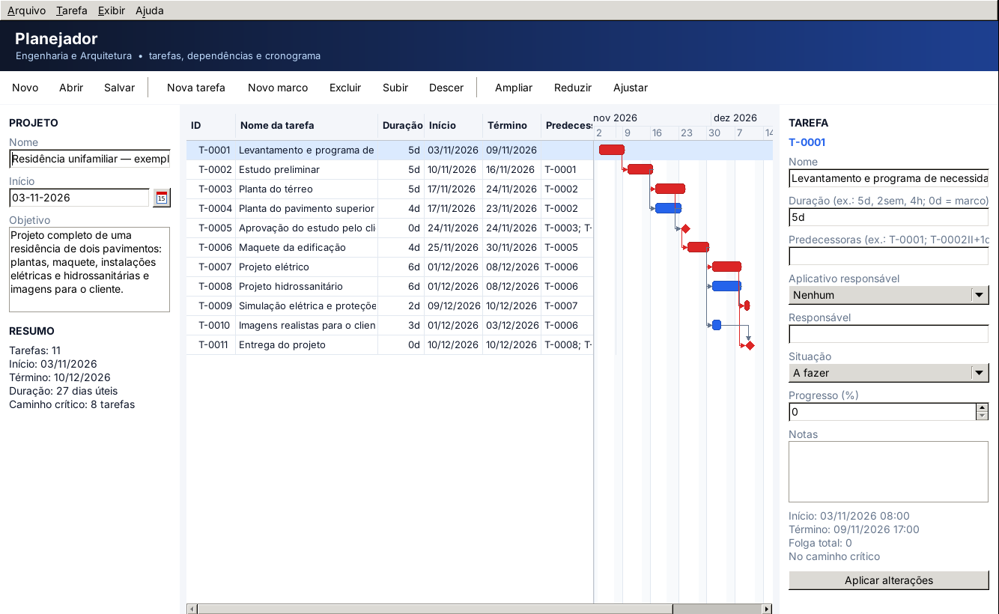
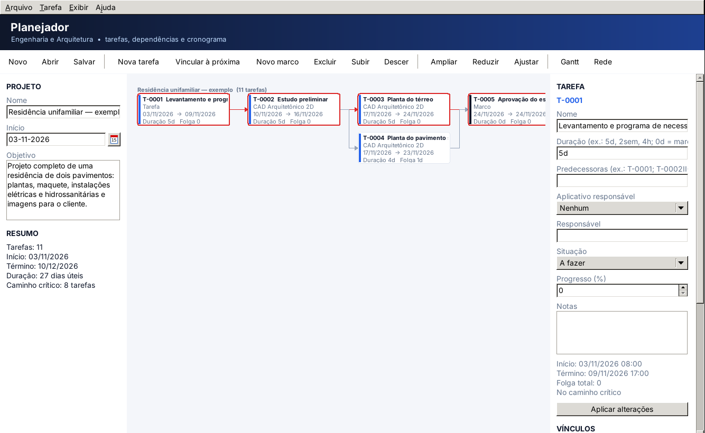

# Planejador

Gerenciador de projetos de engenharia e arquitetura, tendo o Microsoft Project como referência funcional. É a **primeira etapa da linha de produção**: cria as tarefas do empreendimento, define a ordem entre elas e acompanha sua execução nos demais aplicativos da plataforma.

> **Estado:** etapa **P1 implementada** (29/10/2026): tarefas, dependências em grafo, caminho crítico, Gráfico de Gantt e gravação do projeto. Versão 0.2: vínculos entre tarefas como no MultiProject e diagrama de rede (antecipado da etapa P3). Especificação completa e demais etapas em [docs/Planejador.md](../docs/Planejador.md); integrações em [docs/Integracoes.md](../docs/Integracoes.md).





## Posição na plataforma

| Recebe | Produz | Destino |
|---|---|---|
| Retornos de tarefa (arquivo produzido, situação, alertas) de todos os aplicativos | Tarefas, cronograma, dependências e vínculos | CAD 2D, Maquete 3D, Criador de Cenas, Elétrica 3D, SimuEletrica, SimuTubulações |

O Planejador **não produz geometria** e não edita os arquivos dos outros aplicativos: ele referencia arquivos e recebe os retornos.

## O que já funciona (etapa P1)

- **Projeto:** nome, objetivo e data de início, com calendário de segunda a sexta (08:00–12:00 e 13:00–17:00) e feriados nacionais.
- **Tarefas:** inclusão (Insert), marcos (Shift+Insert), exclusão, mudança de ordem (Alt+setas), nome, duração (`5d`, `2sem`, `4h`; `0d` = marco), aplicativo responsável, responsável, situação, progresso e notas.
- **Ligar tarefas** (no padrão do MultiProject do MultiCNC):
  - **Ctrl+F2** ou botão *Vincular à próxima*: liga a tarefa selecionada à de baixo (término-início);
  - **diagrama de rede** (Ctrl+2 ou botão *Rede*): arraste de uma caixa até outra para criar o vínculo; com Alt, o vínculo é início-início;
  - **painel Vínculos**: escolha a sucessora, o tipo (TI, II, TT, IT) e a latência e clique em *Vincular*; a lista mostra os vínculos de entrada e de saída da tarefa, com *Remover vínculo*;
  - **coluna ou campo Predecessoras**, no formato do Microsoft Project (`T-0001; T-0002II+1d`);
  - **Ctrl+Shift+F2** desvincula a tarefa (remove entradas e saídas).
  Auto-vínculo, vínculo repetido, tarefa inexistente e ciclo são recusados, e o rodapé mostra o caminho do ciclo.
- **Cronograma:** datas pelo caminho crítico, folga total e tarefas críticas em vermelho no Gantt e no diagrama de rede, com setas de vínculo.
- **Edição na tabela:** duplo clique ou F2 nas colunas Nome, Duração e Predecessoras.
- **Arquivo:** projeto em JSON versionado (`.plan.json`), com `schema_version` e `package_type`, seguindo o manifesto de [docs/Integracoes.md](../docs/Integracoes.md). O programa também abre um arquivo passado na linha de comando.
- **Exemplo:** Arquivo → Abrir exemplo (residência), também disponível em [examples/residencia.plan.json](examples/residencia.plan.json).

O grafo, o calendário, o caminho crítico, o Gráfico de Gantt e o diagrama de rede vêm da **suíte CHATGPT** (pacotes AIProjectCore e AIProject); ver [third_party/chatgpt](../third_party/chatgpt/README.md).

## Estrutura

```
planejador/
├── src/
│   ├── app/    planejador.lpi, planejador.lpr, plan_principal.pas (janela)
│   ├── core/   plan_tipos, plan_documento, plan_cronograma, plan_exemplos
│   ├── io/     plan_json (gravação e leitura)
│   └── view/   plan_estilo (paleta e componentes visuais)
├── tests/      test_planejador_core (52 verificações do modelo)
├── tools/      gerar_exemplo (gera examples/residencia.plan.json)
├── examples/   residencia.plan.json
└── screenshots/
```

## Instalação

O instalador para Windows 64 bits fica em [`bin/setup_engenhariaarquitetura_002.exe`](../bin/) e o executável avulso em `bin/planejador.exe`, no mesmo padrão do MultiCNC. Como gerar: [installer/windows](../installer/windows/README.md).

## Como compilar

Requer Lazarus 3.0 ou superior. O projeto procura a CHATGPT em `..\CHATGPT\pacote\` (ao lado desta pasta, em `D:\projetos\maurinsoft\CHATGPT`) e, se não encontrar, usa a cópia em `third_party/chatgpt`.

```
lazbuild planejador\src\app\planejador.lpi
bin\planejador.exe planejador\examples\residencia.plan.json
```

Testes do modelo:

```
lazbuild planejador\tests\test_planejador_core.lpi
planejador\tests\lib\test_planejador_core.exe
```

> **Plano detalhado das pendências:** [Auditoria focada do Planejador — 30/10/2026](../docs/Pendencias_Planejador_2026-10-30.md). Reúne correções de segurança de arquivos, integração entre aplicativos (P2), gestão (P3), objetos/skins (P4) e testes necessários. A presença de testes no repositório não equivale à validação nesta auditoria.

## Próximas etapas

| Etapa | Escopo |
|---|---|
| P2 | Contrato de tarefa: abrir a tarefa no aplicativo responsável e receber o retorno |
| P3 | Calendário, uso de recursos, linha de base e curva S (o diagrama de rede já está pronto) |
| P4 | Tarefas de objetos e vínculo de texturas por objeto ou face |
